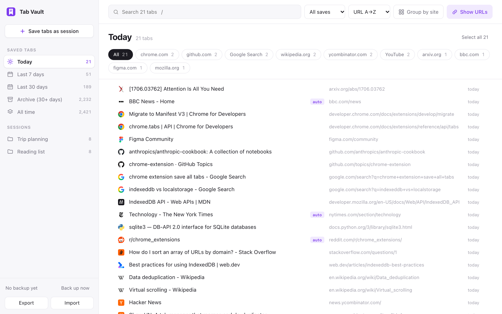
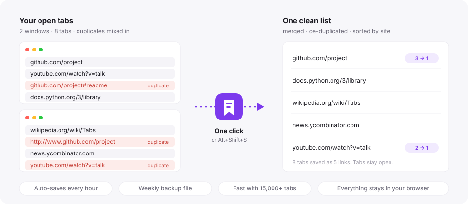
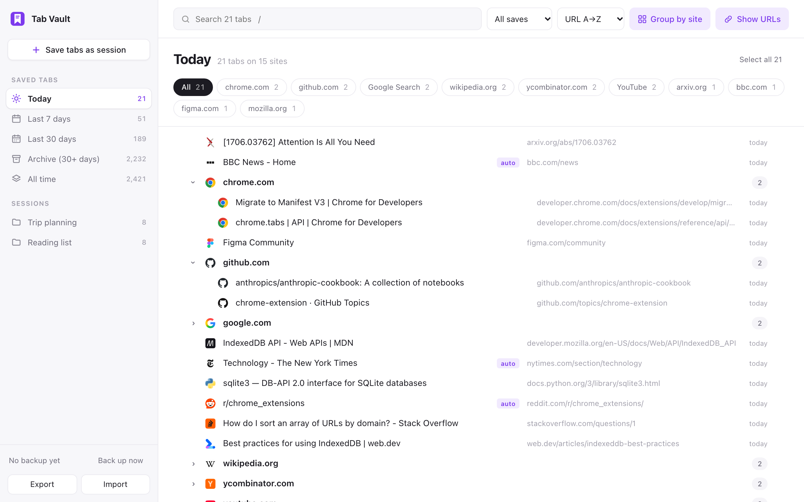

# Tab Vault

A Chrome extension that saves all your open tabs into one list. The list is merged, de-duplicated and sorted by URL automatically, so there is no manual cleanup.

## How it works

Group by site collapses a big list into one row per website:

*Screenshots use example tabs.*

## Install

1. Download this repo (`git clone`, or **Code → Download ZIP** and unzip it).
2. Open `chrome://extensions` in Chrome.
3. Turn on **Developer mode** (top right).
4. Click **Load unpacked** and choose this folder.
5. Pin the bookmark icon from the puzzle-piece menu in the toolbar.

To update later, run `git pull` (or download again), then click the reload arrow on the Tab Vault card in `chrome://extensions`. Your saved tabs are kept.

## Use

- **Click the icon** to save every tab in every window and open the list.
- **Alt+Shift+S** saves without opening the list.
- **Auto-save:** every hour, open tabs are also merged in. Links only auto-save has caught get an **auto** tag, which goes away if you save the link yourself. The **All saves / My saves / Auto-saved** menu filters by this.
- **Undo:** every delete can be undone for 10 seconds (the Undo button or Cmd/Ctrl+Z).
- **Save tabs as session** at the top of the sidebar saves the open tabs as a named session, kept apart from the main list.

In the list:

- **Sidebar:** Today (the default), Last 7 days, Last 30 days, Archive (not saved again for 30+ days), All time, and your sessions. Backup, Export and Import are at the bottom.
- **Search:** press `/`. Several words must all match.
- **Header:** show all saves, only yours, or only auto-saves; sort by site A→Z (local addresses like localhost last), newest or oldest; Group by site; Show URLs.
- **Chips:** your 10 biggest sites in the current view (subdomains count as one site, so every SolveIt dialog is under solve.it.com). Google is split into Search, Gmail and Drive & Docs.
- **Open:** click a title to open it, or Cmd/Ctrl-click to open it in the background.
- **Select:** click a row, or Shift-click to select a range. Open and Delete appear above the list. Esc clears the selection.

## Coming from Session Buddy

In Session Buddy, export everything as JSON. Then click **Import** in Tab Vault and pick that file. For each collection, choose whether it goes into the common list, becomes a session, or is skipped. Session Buddy doesn't store dates for links, so imported links without a date go to the Archive.

## Duplicates

Two links count as the same page when they differ only in:

- `http` vs `https`
- `www.`
- the `#part` at the end (except Gmail and `#/route` style app links, where it identifies the page)

## Backups

Every 7 days, a backup file is saved to `Downloads/TabVault/`, and the newest two are kept. Backups only ever grow: links you delete from the list stay in the backup. **Back up now**, **Export** and **Import** are at the bottom of the sidebar. To restore after Chrome data is lost, click **Import** and pick the newest backup file.

## Where data lives

Everything is stored locally in the browser's IndexedDB. Nothing is sent anywhere.
